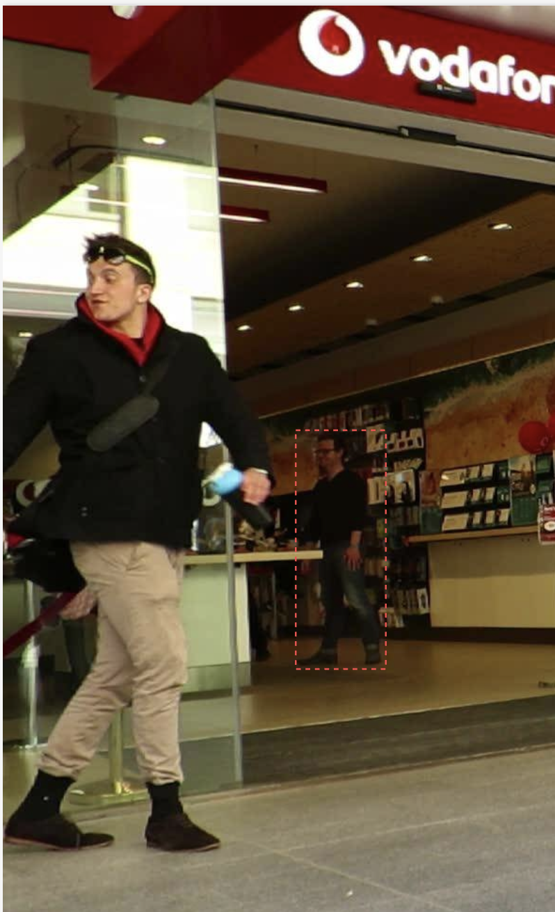
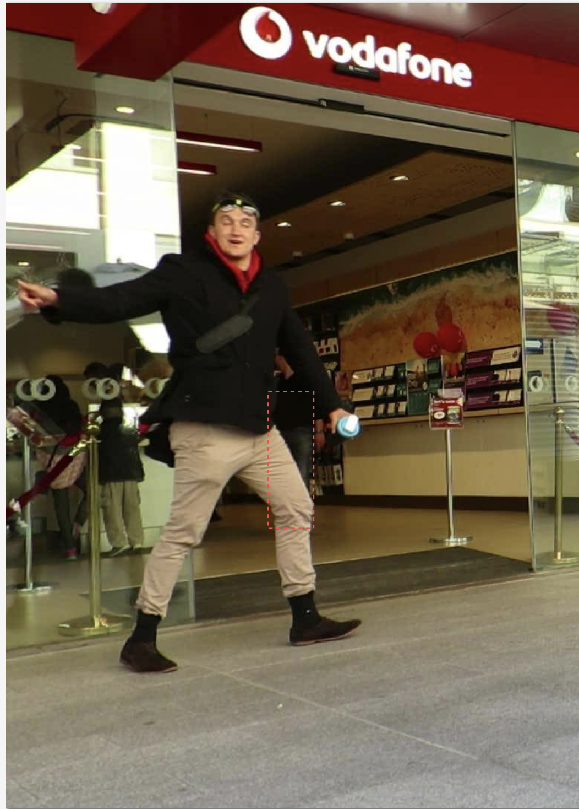
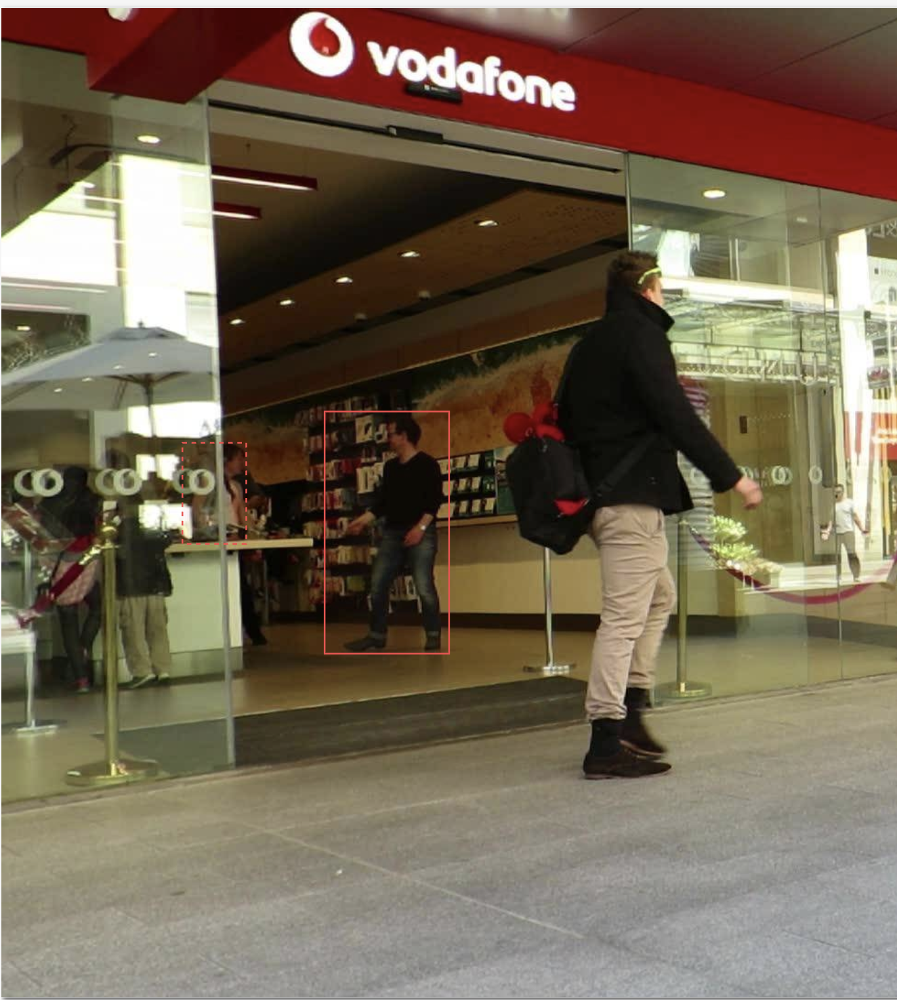

# Báo cáo cá nhân — PhamTranAnh-2A202604057

Đổi tên file theo quy tắc `MSSV_HoTen.md`. Ví dụ: `20241234_NguyenVanAn.md`.

Đoạn video: MOT17-09, 150 frame (frame 1–150), nguồn MOTChallenge, giấy phép CC BY-NC-SA 3.0.

## 0. Thông tin học viên

- Họ tên: Phạm Trần Anh
- MSSV: 2A202604057
- Mã đề (A/B/C): B
- Email: 26ai.anhpt8@vinuni.edu.vn
- Link repository: https://github.com/GemmaP512/K5-L2B-DAY05-PhamTranAnh-2A202604057-MOTTracking
- Giờ bắt đầu: 4h
- Giờ kết thúc: 7h30

## 1. Xem trước đoạn video (CP0)

Mốc xuất hiện và cờ che khuất dưới đây được đối chiếu từ bản xuất cuối, theo số frame CVAT. Ánh xạ P1–P5 dùng Track ID 1–5 trong bảng MOT của kết quả tự kiểm. ID XML tương ứng đếm từ 0.

| Mã | Frame xuất hiện | Frame cuối thấy được | Rẽ / dừng / đổi tốc độ ở frame | Bị che ở frame | Ghi chú |
|---|---|---|---|---|---|
| P1 | 0 | 149 | Chưa ghi | 0–23, 26–54 | MOT ID 4 |
| P2 | 46 | 149 | Rẽ ở frame 56–99 | 46–86 | MOT ID 5 |
| P3 | 0 | 149 | Chưa ghi | Không ghi nhận | MOT ID 2 |
| P4 | 0 | 149 | Chưa ghi | 0–65 | MOT ID 3 |
| P5 | 0 | 149 | Chưa ghi | 105–128, 130–149 | MOT ID 1 |

## 2. Keyframe và thời gian (CP1, CP4)

Số keyframe lấy từ kết quả `src/check_submission.py`.

| Mã | Số keyframe | Keyframe ở frame | Số frame có mặt | Keyframe / 100 frame | Thời gian (phút) | Chỗ khó |
|---|---|---|---|---|---|---|
| P1 | 150 | 0–149 | 150 | 100,0 | 13 | Đoạn ngừoi bị che khuất khó bbox |
| P2 | 104 | 46–149 | 104 | 100,0 | 17 | Khó xác định được frame xuất hiện vì quá nhỉ     |
| P3 | 150 | 0–149 | 150 | 100,0 | 14 | Không |
| P4 | 150 | 0–149 | 150 | 100,0 | 16 | Không |
| P5 | 150 | 0–149 | 150 | 100,0 | 20 | Không |
| **Tổng** | 704 | — | 704 | | |

Keyframe / 100 frame của cả bài = tổng keyframe ÷ tổng số frame có mặt × 100 = 100,0.

Đối chiếu theo ID XML:

| ID XML | Frame có mặt và có keyframe | Số keyframe | Frame bật occluded |
|---:|---|---:|---|
| 0 | 0–149 | 150 | 105–128, 130–149 |
| 1 | 0–149 | 150 | Không có |
| 2 | 0–149 | 150 | 0–65 |
| 3 | 0–149 | 150 | 0–23, 26–54 |
| 4 | 46–149 | 104 | 46–86 |

P1, P3, P4 và P5 cùng có số keyframe cao nhất (150). Cả năm track đều có một keyframe ở mỗi frame có mặt. Lý do đặt keyframe và chỗ khó cần bổ sung từ quá trình gán nhãn.

## 3. Đoạn bị che (CP2)

Người được giao để phân tích: `P1` (MOT ID 4, XML ID 3).

| Mốc | Frame CVAT |
|---|---|
| Bắt đầu bị che một phần (bật `occluded`) | 0 (đã bật ở frame đầu), bật lại ở 26 |
| Mất hẳn (bật `outside`) | 26  |
| Hiện lại (tắt `outside`) | 55 |
| Thấy rõ trở lại (tắt `occluded`) | 24 và 55 |

- Thời gian khuất hẳn: frame 26. Track có box từ frame 0 đến 149 và frame 55.
- Quyết định trong bản xuất: giữ cùng ID qua cả hai đoạn bật `occluded` (0–23 và 26–54).
- Lý do: hai đoạn được gán là che một phần, nên bản xuất vẫn giữ box và cùng ID. Cần đối chiếu trong CVAT xem có frame nào P1 mất hẳn không, đồng thời xác nhận ngoại hình, hướng đi và tốc độ trước và sau đoạn che.

Ảnh chụp màn hình (nguồn MOT17, MOTChallenge, Milan et al., 2016):





## 4. Tự review ID (CP3)

Lượt 1 theo người (đi ngược từ frame 149 về 0 trên CVAT), lượt 2 theo cảnh (nhảy 10 frame). Ít nhất 3 dòng; không có lỗi thì ghi một dòng "đã kiểm hai lượt, không lỗi".

Loại lỗi dùng đúng một trong 7 mã: `id_switch`, `fragmentation`, `lost`, `merge`, `false_track`, `drift`, `flag`.

| Frame | Mã người | Loại lỗi | Mô tả một câu | Phát hiện ở lượt | Đã sửa? |
|---:|---|---|---|---|---|
| 47 | P2 | `drift` | Script cảnh báo chiều cao box đổi hơn 30% so với frame 46. | | Đã sửa |
| 53 | P1 | `drift` | Script cảnh báo chiều cao box đổi hơn 30% so với frame 52. | | Đã sửa |
| 67 | P2 | `drift` | Script cảnh báo chiều cao box đổi hơn 30% so với frame 66. | | Đã sửa |

Tổng hợp số lỗi theo loại:

| `id_switch` | `fragmentation` | `lost` | `merge` | `false_track` | `drift` | `flag` |
|---:|---:|---:|---:|---:|---:|---:|
| 0 | 0 | 0 | 0 | 0 | 3 | 0 |

Lỗi nào chỉ lượt 2 (theo cảnh) mới thấy, lượt 1 (theo người) không thấy? Vì sao?

Chưa ghi nhận lỗi nào chỉ phát hiện ở lượt 2. Ba lỗi `drift` trong bảng được ghi từ cảnh báo của script và chưa có thông tin về lượt phát hiện. Xem theo cảnh giúp so sánh nhiều box cùng lúc, nên dễ nhận ra hai box cùng bám một người hoặc một box bao hai người đi sát nhau.

## 5. File xuất và kết quả tự kiểm (CP4)

| Kiểm tra | Kết quả |
|---|---|
| Tên file MOT 1.1 | `PhamTranAnh_mot.zip` |
| Tên file CVAT for video 1.1 | `PhamTranAnh_cvat_video.zip` |
| Số track ID khác nhau trong `gt/gt.txt` (phải là 5) | 5 |
| Frame `outside` không có dòng trong `gt.txt` (đúng / sai) | Chưa có frame bật `outside` trong XML để đối chiếu. |
| Job đã completed trên CVAT máy cá nhân | Cần xác nhận trạng thái job. |

Dán phần tóm tắt in ra từ `src/check_submission.py`:

```text
Số track ID: 5   |   Tổng số box: 704
[OK]        Đọc được 5 track từ annotations.xml.
Lỗi: 0   |   Cảnh báo: 7
```

Script cảnh báo mật độ keyframe ở cả 5 track và chiều cao box thay đổi hơn 30% tại các frame 47, 53, 67 (số frame CVAT).

## 6. Ba câu kết

1. Nếu được gán lại, bạn sẽ đặt keyframe khác ở đâu? Vì sao?

   Đặt lại keyframe ở đâu? Kiểm tra P2 ở frame 46–47 và 66–67, P1 ở frame 52–53. Ở các đoạn này, chiều cao box thay đổi hơn 30% trong một frame. Nếu box bị co theo phần thân nhìn thấy, hãy chỉnh lại để box bao toàn thân ước lượng. Giữ keyframe ở chỗ đổi hướng, đổi kích thước hoặc bắt đầu bị che. Đoạn đi đều có thể dùng ít keyframe hơn và tua lại để kiểm tra nội suy.

2. Có chỗ nào bạn không chắc "cùng ID hay ID mới"? Bạn đã quyết định và ghi chú thế nào?

   Giữ ID hay tạo ID mới? Bản xuất cho thấy P1 giữ cùng ID qua hai đoạn bật occluded, frame 0–23 và 26–54, và không có frame nào bật outside. Nếu bạn từng phân vân, hãy ghi đúng frame và dấu hiệu bạn dùng để nhận ra cùng người, chẳng hạn quần áo hoặc hướng đi. Nếu bạn không gặp tình huống phân vân, ghi rõ điều đó.

3. Một lỗi ID trong job của bạn (nếu không còn sót, chọn lỗi đã sửa) có thể làm xe tự lái dự đoán sai chuyển động của người đó như thế nào? Lỗi đó ảnh hưởng MOTA hay IDF1 nhiều hơn?

   Ảnh hưởng đến dự đoán chuyển động và chỉ số? Mục 4 hiện ghi drift. Box co hoặc lệch đột ngột có thể làm tâm box nhảy, khiến hệ thống ước lượng sai hướng hoặc tốc độ. Nếu box lệch đến mức không còn ghép được với ground truth, MOTA có thể giảm do tăng box bỏ sót và box thừa. Nếu bạn từng xác nhận lỗi đổi ID hoặc đứt track, hãy dùng lỗi đó để trả lời đúng câu hỏi về ID. Khi ID sai kéo dài, IDF1 phản ánh trực tiếp việc mất tính liên tục của danh tính.

## Bonus (nếu làm)

### B1 — Hai người đi sát

...

### B2 — So cách đặt keyframe

| Cách đặt | Số keyframe | Frame trôi nhất | Ghi chú |
|---|---:|---:|---|
| Đều mỗi 30 frame | | | |
| Theo chỗ đổi hướng | | | |

...

### B3 — So với tracker có sẵn

| Frame | Mã người | Tracker làm gì | Nhãn của bạn | Giải thích (đoán rồi sửa / ghép IoU / box score thấp / ngoại hình) |
|---:|---|---|---|---|
| | | | | |
| | | | | |

## 7. Tài liệu tham khảo và công cụ AI đã dùng

- Dữ liệu: MOT17, MOTChallenge (Milan et al., 2016).
- Codex để sửa báo cáo
